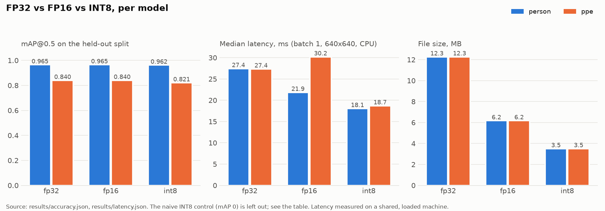
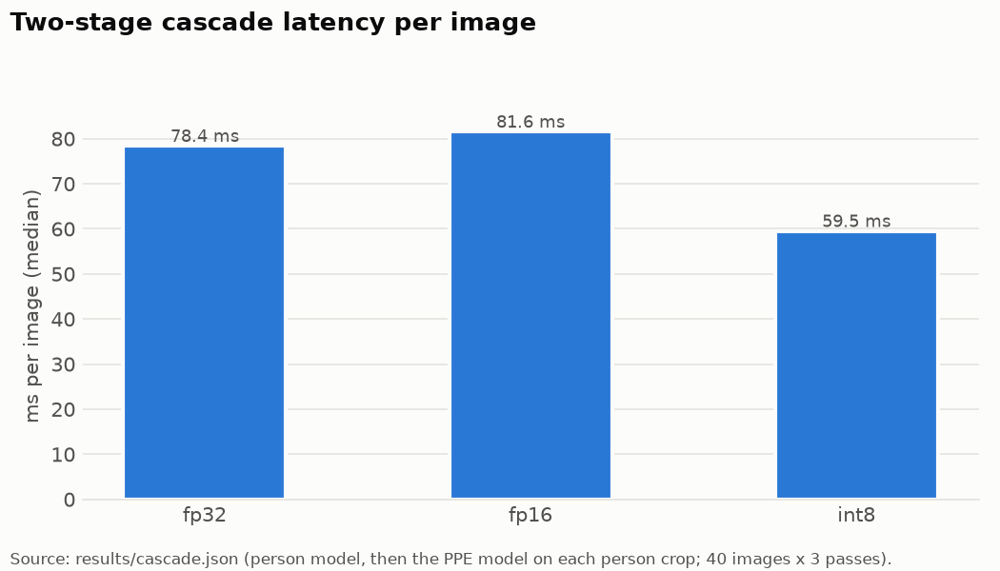

# ppe-quantization-lab

Export a two-stage YOLOv8n PPE detector (person -> crop -> PPE) to ONNX, make FP16 and INT8
(static QDQ) variants, and measure accuracy, size, CPU latency and memory for each.
Everything below the "Results" heading is generated from `results/*.json` by `scripts/render_readme.py`.

Source models and data: `Yolov8_Person_and_PPE_detection` (`weights/person.pt`, `weights/ppe.pt`, `datasets.zip`).
`weights/*.pt` and `models/*.onnx` are committed (each file is under 50 MB). The dataset zip is not.

## Data split (read this first)

- The original train/val/test split was **not recoverable**: the zip contains no split folders and the
  original `Split_dataset.py` shuffles without a seed.
- So the split is **regenerated**: same 70/20/10 ratios and cutoffs as `Split_dataset.py`, sorted file list,
  `random.Random(0).shuffle` (seed 0). 395 images -> 276 train / 79 val / 40 test (`data/split.json`).
- **The provided weights were trained on an unknown split of this same data, so the "held-out" images may
  have been seen in training.** Treat absolute mAP as optimistic. The comparison between variants is still
  fair (same images, same evaluator). INT8 calibration uses the train split only.
- PPE evaluation uses person crops (`crop.py` logic), because `ppe.pt` was trained on crops.
- `ppe.pt` has **7 classes** (hard-hat, gloves, mask, glasses, boots, vest, ppe-suit), not the 9 in `classes.txt`.
  Labels for ear-protector / safety-harness would be dropped; the dataset has 0 such boxes (`dropped_boxes_unknown_class` in `data/split.json`).
- Ultralytics ignores images under 10 px on a side, so the 125 PPE test crops are evaluated as 123.

## Setup

```bash
uv venv --python 3.12 .venv
uv pip install -p .venv/bin/python -r requirements.txt
# dataset zip from the source repo (path is yours):
.venv/bin/python scripts/prepare_data.py --zip /path/to/datasets.zip --out data
```

## Run

```bash
.venv/bin/python scripts/export_models.py       # .pt -> models/*_fp32.onnx and *_fp16.onnx
.venv/bin/python scripts/quantize_int8.py       # -> models/*_int8.onnx (QDQ, head decode ops kept in float)
.venv/bin/python scripts/quantize_int8.py --head none --suffix int8_naive   # negative control: quantize everything
.venv/bin/python scripts/eval_map.py            # results/accuracy.json   (ultralytics val on the .onnx files)
.venv/bin/python scripts/bench_latency.py       # results/latency.json    (size, latency, peak RSS)
.venv/bin/python scripts/bench_cascade.py       # results/cascade.json    (person -> crop -> PPE, end to end)
.venv/bin/python scripts/render_readme.py       # rewrites the results block below
.venv/bin/python -m pytest -q tests             # unit tests + Streamlit smoke test
.venv/bin/streamlit run app.py                  # UI: variants side by side + latency-vs-mAP chart
```

## How it is measured

- **mAP**: `ultralytics` `val` on each `.onnx` (ONNX Runtime CPU EP, batch 1, 640, conf 0.001, IoU 0.7). No custom evaluator.
- **Latency**: ONNX Runtime CPU EP, batch 1, 1x3x640x640, 20 warmup + 200 timed `session.run()` calls, median and p95. Inference only (no pre/post). Default ORT thread count on a 10-core Apple M4.
- **Peak memory**: psutil RSS polled every 2 ms in a fresh subprocess per variant (includes the Python + ORT baseline, stored as `baseline_rss_mb`).
- **Cascade**: letterbox + inference + decode for the person model, then for every detected person crop, conf 0.25, IoU 0.45, both models on the same variant. 1 untimed warmup pass + 3 timed passes over the 40 held-out images.
- **Timing caveat**: the machine was shared with other jobs while these ran. `loadavg_before/after` in `results/latency.json` and `results/cascade.json` records the 1-minute load average (10 cores); treat latency differences of a few ms as noise.

## Variants

| variant | what |
|---|---|
| fp32 | ultralytics ONNX export, opset 17, onnxslim, static 1x3x640x640 |
| fp16 | ORT `convert_float_to_float16`, `keep_io_types=True` (float32 in/out, float16 inside) |
| int8 | ORT static quantization, QDQ, uint8 activations / int8 per-channel weights, MinMax, 100 train images; the Detect-head decode ops (`/model.22/` Concat, Sigmoid, DFL, Slice, Mul ...) stay float |
| int8_naive | same, but nothing excluded. Included as a negative control: the class scores collapse and mAP is 0 |

## Results

<!-- charts:start -->
### Charts

Drawn from the JSON in `results/` by `scripts/make_charts.py`; the tables below hold the exact numbers.




<!-- charts:end -->

<!-- results:start -->
**person.pt** (40 held-out images)

| variant | mAP50 | mAP50-95 | size MB | median ms | p95 ms | peak RSS MB |
|---|---|---|---|---|---|---|
| fp32 | 0.9649 | 0.8209 | 12.27 | 27.45 | 39.34 | 206 |
| fp16 | 0.9651 | 0.8215 | 6.17 | 21.87 | 31.52 | 214 |
| int8 | 0.9621 | 0.8085 | 3.51 | 18.06 | 23.03 | 131 |
| int8_naive | 0.0000 | 0.0000 | 3.44 | 15.56 | 20.73 | 126 |

**ppe.pt** (123 held-out person crops)

| variant | mAP50 | mAP50-95 | size MB | median ms | p95 ms | peak RSS MB |
|---|---|---|---|---|---|---|
| fp32 | 0.8404 | 0.6479 | 12.27 | 27.36 | 43.54 | 206 |
| fp16 | 0.8405 | 0.6481 | 6.17 | 30.20 | 48.25 | 213 |
| int8 | 0.8210 | 0.6192 | 3.51 | 18.70 | 24.67 | 130 |
| int8_naive | 0.0000 | 0.0000 | 3.45 | 15.56 | 21.62 | 126 |

**Two-stage cascade, end to end per image** (40 held-out images x 3 timed passes)

| variant | median ms | p95 ms | person stage median ms | PPE stage median ms | persons/image | PPE boxes/image |
|---|---|---|---|---|---|---|
| fp32 | 78.4 | 238.1 | 25.3 | 52.0 | 3.00 | 8.00 |
| fp16 | 81.6 | 274.5 | 26.1 | 53.3 | 3.00 | 7.90 |
| int8 | 59.5 | 189.7 | 20.5 | 37.7 | 2.92 | 7.33 |
| int8_naive | 16.1 | 19.8 | 16.1 | 0.0 | 0.00 | 0.00 |
<!-- results:end -->
